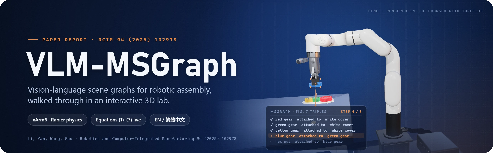
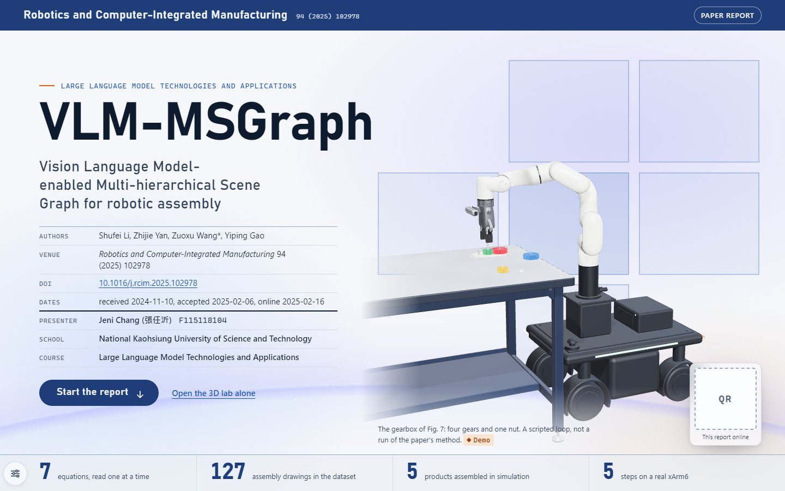
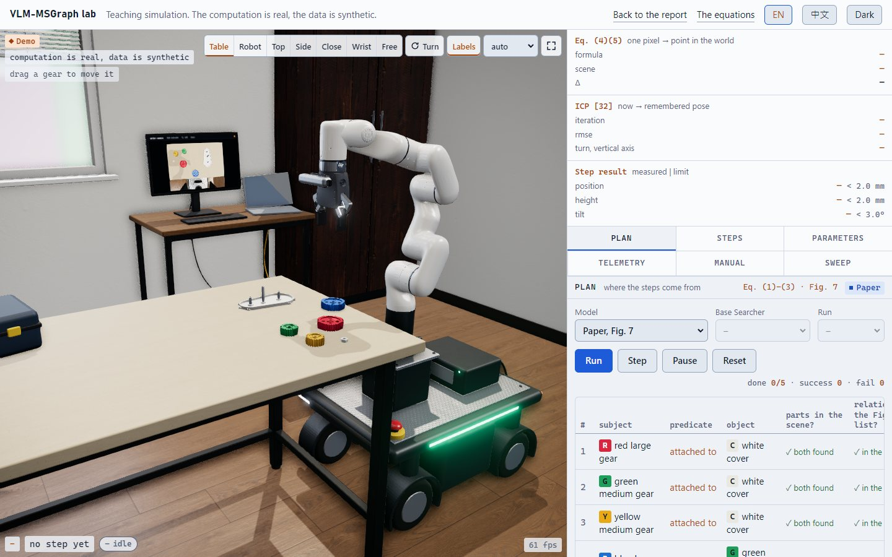
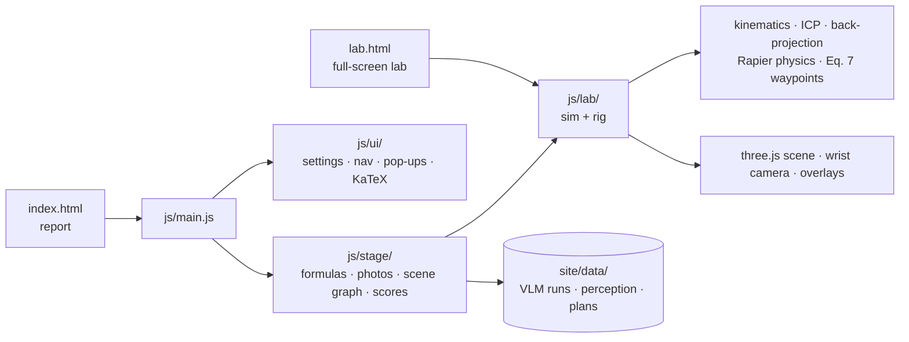

<p align="center">
  
</p>

<h1 align="center">VLM-MSGraph: an interactive paper report</h1>

<p align="center">
  A web report on Li et al., <em>VLM-MSGraph</em> (RCIM 94, 2025), with a browser 3D lab where the paper's equations run on a simulated xArm6.
</p>

<p align="center">
  <a href="https://naritaroad.github.io/vlm-msgraph-robotic-assembly-report/"><b>Live report</b></a> ·
  <a href="https://naritaroad.github.io/vlm-msgraph-robotic-assembly-report/lab.html">3D lab</a> ·
  <a href="https://doi.org/10.1016/j.rcim.2025.102978">Paper</a> ·
  <a href="https://github.com/naritaroad/vlm-msgraph-robotic-assembly-report/issues">Issues</a>
</p>

<p align="center">
  <a href="https://github.com/naritaroad/vlm-msgraph-robotic-assembly-report/actions/workflows/pages.yml"></a>
  <a href="https://doi.org/10.1016/j.rcim.2025.102978"></a>
  
  
  
  <a href="#license"></a>
</p>

<p align="center"><b>English</b> | <a href="README.zh-TW.md">繁體中文</a></p>

---

## Features

- **Eleven knowledge points.** Each section pairs an article (equation, symbol table, worked substitution, and the paper's own inconsistencies at that point) with a stage that shows it.
- **Equations (1)–(7) you can click.** KaTeX typesets every equation; each symbol opens its definition, and a switch replaces symbols with live values.
- **A 3D lab built on the paper's five-step gear assembly (§4.2).** xArm6 and gripper meshes from `xarm_ros`, Rapier rigid-body physics and a wrist RGB-D camera rendered off-screen. Depth back-projection (Eq. 4–6), centroid plus ICP, inverse kinematics and the Eq. (7) waypoints are computed in the browser.
- **Recorded VLM runs, not live API calls.** GPT-4o and GPT-4o-mini were run on desk photos with the paper's Fig. 5 prompt flow; GPT-4o, GPT-4o-mini and a local gemma3:4b were run on lab renders. Raw outputs sit in `site/data/vlm/raw/`, and each lab output becomes one plan the robot can execute.
- **Detection and segmentation on real footage.** Grounding DINO and SAM 2.1 results for the photos and videos are in `site/data/perception/`.
- **Evidence tags on claims.** `Paper`, `Derived`, `Not stated`, `Mismatch` and six more; the simulation is tagged `Demo`, measured runs are tagged `Local run`.
- **English and Traditional Chinese, light and dark.** One settings panel holds language, theme, how the stage follows the article, symbol or value display, column side and font size.
- **Fully local assets.** Libraries, fonts, models and textures ship in `site/`; the page makes no CDN or font requests.

## Demo

Open the [live report](https://naritaroad.github.io/vlm-msgraph-robotic-assembly-report/) or go straight to the [3D lab](https://naritaroad.github.io/vlm-msgraph-robotic-assembly-report/lab.html).

| Cover | 3D lab |
| --- | --- |
|  |  |

> [!NOTE]
> This is a course report, not a reproduction. Tables 1–3 of the paper are not reproduced, no real robot or depth camera was used, and the paper released no code (its data is "available on request"). The gearbox in the lab is our own model, so the lab is a teaching simulation.

## Architecture



The site is plain HTML, CSS and native ES modules with an import map, so GitHub Pages serves `site/` as is. The lab splits into a steppable simulation (pure math, testable in Node) and a rendering rig that only reads it. Content is written in a separate private repo and built into `site/`; this repo receives the built files. Details: [docs/architecture.md](docs/architecture.md).

## Technical details

<details>
<summary><b>Stack</b></summary>

| Part | Version | Licence |
| --- | --- | --- |
| three.js | 0.186.1 | MIT |
| `@dimforge/rapier3d-compat` (wasm inlined) | 0.21.0 | Apache-2.0 |
| KaTeX | 0.16.25 | MIT |
| xArm6 and gripper meshes, from `xarm_ros` | — | BSD-3-Clause |
| HDRI and PBR textures, from Poly Haven | — | CC0 |

The mobile base and wrist camera are simplified shapes we modelled, not vendor CAD. Every third-party file is listed in [site/assets/LICENSES.md](site/assets/LICENSES.md).
</details>

<details>
<summary><b>Evidence tags</b></summary>

| Tag | Meaning |
| --- | --- |
| `Paper` | Written in the paper |
| `Derived` | Follows from the paper; the derivation is on the page |
| `Not stated` | The paper does not say |
| `Mismatch` | The paper contradicts itself (text vs. figure, equation dimensions) |
| `Loose` | Not wrong, but imprecise |
| `Citation` | A problem with a cited reference |
| `Demo` | Teaching simulation, not data from the paper |
| `Local run` | Actually run on our machine |
| `External` | A source other than the paper |
| `My view` | The presenter's own judgement |
</details>

<details>
<summary><b>Settings and interaction</b></summary>

The settings button sits at the bottom left of the report. It holds language, theme (system, light, dark), stage sync (off, sync, precise), symbols or live values in equations, article on the left or right, font size and a timer. The divider between article and stage can be dragged. Terms, equations and symbols are clickable, and gears in the 3D scenes can be dragged with the mouse.
</details>

## Installation

Prerequisites: any static file server, for example Python 3 or Node.js.

```bash
git clone https://github.com/naritaroad/vlm-msgraph-robotic-assembly-report.git
cd vlm-msgraph-robotic-assembly-report
python -m http.server 8000 -d site
```

Then open <http://localhost:8000>. Opening `site/index.html` from the file system does not work: browsers block ES modules and model loading over `file://`.

Deployment: [.github/workflows/pages.yml](.github/workflows/pages.yml) uploads `site/` to GitHub Pages on every push to `main` that touches it. In the repository settings, set **Pages → Source** to **GitHub Actions**.

## Project structure

```text
vlm-msgraph-robotic-assembly-report/
├── .github/workflows/pages.yml   deploys site/ to GitHub Pages
├── docs/
│   ├── architecture.md           module map and technical decisions
│   ├── zh-TW/architecture.md
│   └── assets/                   banner and screenshots for this README
├── site/                         the published report (built files)
│   ├── index.html                report: cover, then article and stage
│   ├── lab.html                  full-screen 3D lab
│   ├── css/  js/                 styles and ES modules
│   ├── data/                     paper numbers, VLM runs, perception, lab plans
│   ├── media/                    figures, photos, 1080p videos with captions
│   ├── assets/                   robot meshes, HDRI, textures, LICENSES.md
│   └── vendor/                   three.js, Rapier, KaTeX
├── CHANGELOG.md
├── CONTRIBUTING.md
├── LICENSE                       MIT, for the code
├── LICENSE-CONTENT               CC BY 4.0, for the report content
├── README.md
└── README.zh-TW.md
```

## Contributing

This is a graded course report, so pull requests are not merged. If you find a factual error about the paper or a broken demo, open an [issue](https://github.com/naritaroad/vlm-msgraph-robotic-assembly-report/issues) with the section and what you expected. See [CONTRIBUTING.md](CONTRIBUTING.md).

## License

Code (HTML, CSS, JavaScript, workflows) is released under the [MIT License](LICENSE). Report content (text, redrawn figures, procedural 3D models, the author's photos and videos, the data produced for this report, the banner and screenshots) is released under [CC BY 4.0](LICENSE-CONTENT). Third-party files in `site/vendor/` and `site/assets/` keep their own licences, listed in [site/assets/LICENSES.md](site/assets/LICENSES.md). Cropped figures from the paper remain the publisher's copyright and are shown with a citation for comment. This report is not affiliated with the paper's authors or the publisher.
