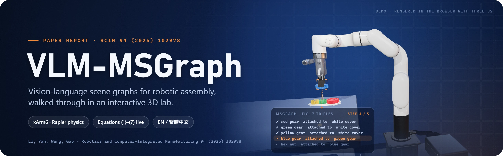
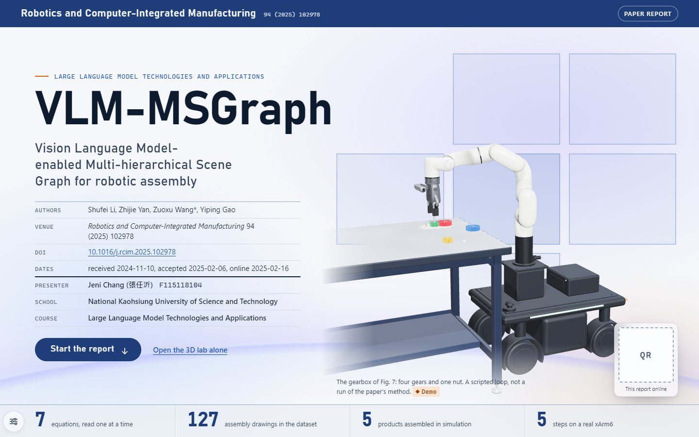
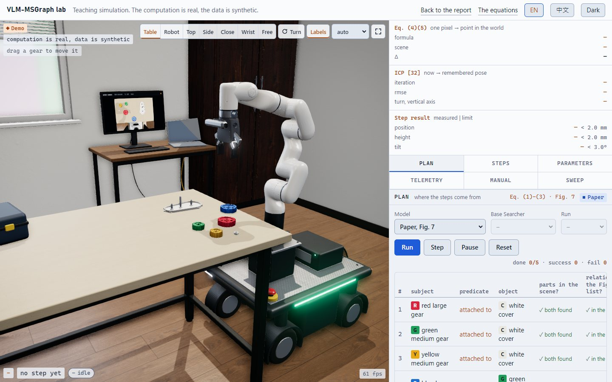
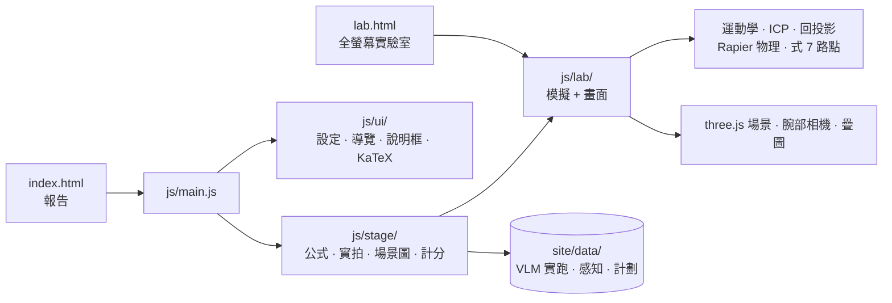

<p align="center">
  
</p>

<h1 align="center">VLM-MSGraph 互動式論文報告</h1>

<p align="center">
  Li 等人 <em>VLM-MSGraph</em>（RCIM 94，2025）的網頁報告，附一座瀏覽器 3D 實驗室，讓論文的式子在模擬的 xArm6 上實際算一遍。
</p>

<p align="center">
  <a href="https://naritaroad.github.io/vlm-msgraph-robotic-assembly-report/"><b>線上報告</b></a> ·
  <a href="https://naritaroad.github.io/vlm-msgraph-robotic-assembly-report/lab.html">3D 實驗室</a> ·
  <a href="https://doi.org/10.1016/j.rcim.2025.102978">論文</a> ·
  <a href="https://github.com/naritaroad/vlm-msgraph-robotic-assembly-report/issues">Issues</a>
</p>

<p align="center">
  <a href="https://github.com/naritaroad/vlm-msgraph-robotic-assembly-report/actions/workflows/pages.yml"></a>
  <a href="https://doi.org/10.1016/j.rcim.2025.102978"></a>
  
  
  
  <a href="#授權"></a>
</p>

<p align="center"><a href="README.md">English</a> | <b>繁體中文</b></p>

---

## 功能

- **十一個知識點。** 每一節一邊是文章（公式、符號表、逐步代入，以及論文在這裡前後不一致的地方），一邊是對應的舞台。
- **式 (1)–(7) 都能點。** 公式用 KaTeX 排版，點符號會跳出定義；切換開關可以把符號換成即時數值。
- **依論文 §4.2 五步齒輪組裝搭的 3D 實驗室。** xArm6 與夾爪網格取自 `xarm_ros`，剛體物理用 Rapier，腕部 RGB-D 相機離屏渲染。深度回投影（式 4–6）、質心加 ICP、逆運動學與式 (7) 路點都在瀏覽器裡實算。
- **VLM 是預跑的結果，不在網頁上即時呼叫 API。** 照論文圖 5 的提示詞流程，對桌上實物照片跑 GPT-4o 與 GPT-4o-mini；對實驗室渲染圖跑 GPT-4o、GPT-4o-mini 與本機的 gemma3:4b。原始輸出放在 `site/data/vlm/raw/`，實驗室的每份輸出就是手臂能執行的一份計劃。
- **實拍畫面的偵測與分割。** 照片與影片的 Grounding DINO、SAM 2.1 結果在 `site/data/perception/`。
- **陳述附證據標籤。** `Paper`、`Derived`、`Not stated`、`Mismatch` 等十種；模擬標 `Demo`，實際跑過的標 `Local run`。
- **英文與繁體中文、淺色與深色。** 語言、主題、舞台怎麼跟著文章、公式顯示符號或數值、文章放左或右、字級，都收在同一個設定面板。
- **資源全部在本地。** 函式庫、字型、模型與貼圖都放在 `site/`，頁面不向 CDN 或外部字型服務發請求。

## 示範

打開[線上報告](https://naritaroad.github.io/vlm-msgraph-robotic-assembly-report/)，或直接進 [3D 實驗室](https://naritaroad.github.io/vlm-msgraph-robotic-assembly-report/lab.html)。

| 封面 | 3D 實驗室 |
| --- | --- |
|  |  |

> [!NOTE]
> 這是課堂報告，不是重現實驗。沒有重現論文的表 1–3，沒有用真的機器人或深度相機；論文沒有釋出程式，資料寫「available on request」。實驗室的齒輪箱是我們自己設計的，所以整座實驗室是教學模擬。

## 架構



網站只用 HTML、CSS 與原生 ES modules 加 import map，GitHub Pages 直接把 `site/` 原樣發布。實驗室分成可步進的模擬（純數學，能在 Node 裡測）和只讀模擬狀態的畫面層。內容在另一個私有 repo 撰寫並建置成 `site/`，這個 repo 只收建置好的檔案。細節見 [docs/zh-TW/architecture.md](docs/zh-TW/architecture.md)。

## 技術細節

<details>
<summary><b>技術組成</b></summary>

| 項目 | 版本 | 授權 |
| --- | --- | --- |
| three.js | 0.186.1 | MIT |
| `@dimforge/rapier3d-compat`（wasm 內嵌） | 0.21.0 | Apache-2.0 |
| KaTeX | 0.16.25 | MIT |
| xArm6 與夾爪網格，取自 `xarm_ros` | — | BSD-3-Clause |
| HDRI 與 PBR 貼圖，取自 Poly Haven | — | CC0 |

移動底盤與腕部相機是我們自己建的簡化外型，不是廠商 CAD。所有第三方檔案逐項列在 [site/assets/LICENSES.md](site/assets/LICENSES.md)。
</details>

<details>
<summary><b>證據標籤</b></summary>

| 標籤 | 意思 |
| --- | --- |
| `Paper` | 論文原文寫的 |
| `Derived` | 從論文推得出，推導步驟在頁面上 |
| `Not stated` | 論文沒寫 |
| `Mismatch` | 論文前後對不上（正文與圖、式子維度等） |
| `Loose` | 不算錯，但說法不嚴謹 |
| `Citation` | 引用文獻的問題 |
| `Demo` | 教學模擬，不是論文數據 |
| `Local run` | 這台電腦實際跑過的結果 |
| `External` | 論文以外的資料 |
| `My view` | 報告者自己的判斷 |
</details>

<details>
<summary><b>設定與操作</b></summary>

設定鈕在報告左下角，裡面有語言、主題（跟系統、淺色、深色）、舞台同步（不同步、同步、精準同步）、公式顯示符號或即時數值、文章放左或右、字級與計時。文章與舞台中間的分隔線可以拖。專名、公式、公式裡的符號都可以點，3D 場景裡的齒輪可以用滑鼠搬。
</details>

## 安裝

需求：任何靜態檔案伺服器，例如 Python 3 或 Node.js。

```bash
git clone https://github.com/naritaroad/vlm-msgraph-robotic-assembly-report.git
cd vlm-msgraph-robotic-assembly-report
python -m http.server 8000 -d site
```

再打開 <http://localhost:8000>。直接從檔案總管雙擊 `site/index.html` 打不開：瀏覽器在 `file://` 下會擋 ES modules 與模型載入。

部署：[.github/workflows/pages.yml](.github/workflows/pages.yml) 在每次推到 `main` 且動到 `site/` 時，把 `site/` 上傳到 GitHub Pages。repo 設定裡的 **Pages → Source** 要選 **GitHub Actions**。

## 專案結構

```text
vlm-msgraph-robotic-assembly-report/
├── .github/workflows/pages.yml   把 site/ 部署到 GitHub Pages
├── docs/
│   ├── architecture.md           模組地圖與技術決定
│   ├── zh-TW/architecture.md
│   └── assets/                   這份 README 的橫幅與截圖
├── site/                         發布的報告（建置產物）
│   ├── index.html                報告：封面，往下是文章與舞台
│   ├── lab.html                  全螢幕 3D 實驗室
│   ├── css/  js/                 樣式與 ES modules
│   ├── data/                     論文數字、VLM 實跑、感知結果、實驗室計劃
│   ├── media/                    論文圖、照片、附字幕的 1080p 影片
│   ├── assets/                   機器人網格、HDRI、貼圖、LICENSES.md
│   └── vendor/                   three.js、Rapier、KaTeX
├── CHANGELOG.md
├── CONTRIBUTING.md
├── LICENSE                       MIT，程式碼
├── LICENSE-CONTENT               CC BY 4.0，報告內容
├── README.md
└── README.zh-TW.md
```

## 參與貢獻

這是要評分的課堂報告，所以不合併 pull request。如果發現關於論文的事實錯誤或壞掉的演示，請開 [issue](https://github.com/naritaroad/vlm-msgraph-robotic-assembly-report/issues)，寫明哪一節、預期看到什麼。見 [CONTRIBUTING.md](CONTRIBUTING.md)。

## 授權

程式碼（HTML、CSS、JavaScript、workflow）採用 [MIT License](LICENSE)。報告內容（文字、重繪的圖、程序化 3D 模型、作者拍攝的照片與影片、為本報告產生的資料、橫幅與截圖）採用 [CC BY 4.0](LICENSE-CONTENT)。`site/vendor/` 與 `site/assets/` 裡的第三方檔案依各自授權，逐項列在 [site/assets/LICENSES.md](site/assets/LICENSES.md)。論文圖的裁切著作權仍屬原出版者，報告標明出處用於評論。本報告與論文作者及出版社無關。
